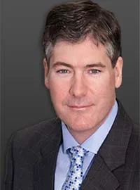

Dr. Gregory T Lynam is the only board-certified plastic and maxillofacial surgeon in Richmond, VA.

Dr. Lynam attended The University of Richmond and obtained a dental and medical degree at the Medical College of Virginia. While attending the Medical College of Virginia, Dr. Lynam entered the plastic surgery training program, prior to which he had spent several years training in general surgery.

During his years of training, Dr. Lynam studied procedures for the entire body and obtained invaluable experience in both reconstructive and cosmetic surgery.

Dr. Lynam’s offices are located at 8720 Stony Point Parkway, Suite 100 in Richmond, VA. Dr. Lynam was voted as one of the”Best Plastic Surgeons to take you back 20 years” in 2010 by Richmond Magazine.

Which provides a range of skin rejuvenation procedures including chemical peels and laser treatments as well as offering leading skincare products.

## Why board certification is important?

Below are some of the reasons why board certification is such a coveted credential in the medical community.

-   A guarantee of standards – Once a doctor is licensed in the United States, they are able to practice any field. However licensing is not a guarantee that they specialize in the particular field they’re practicing. Experience is extremely important when it comes to cosmetic surgery and board certification lets you know that a doctor has trained extensively in the field they’re practicing and have passed a number of written and oral exams.
-   Board certified surgeons must keep up with the latest advancements in their field – Keeping up with advancements is hugely important when it comes to cosmetic, since there are new products and practices arising all the time.
-   Best practices in patient safety, communication and ethics must be upheld – Board certification also means that a doctor must be the safety of their patients above all else. They must also demonstrate excellent communication skills.
