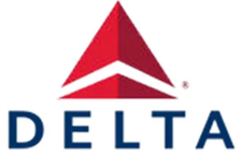
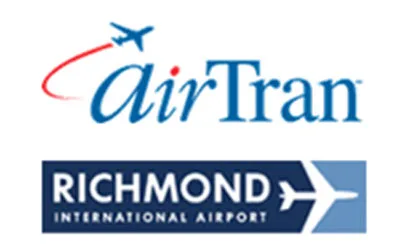
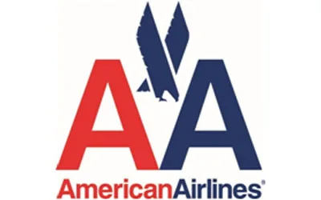

## **Have a question ? How to reach Richmond**

Check out our Richmond Airlines guide

[Delta Airlines
](http://www.delta.com/)

[804-226-1923](<tel:\(804\) 226-1923>)

“One of the world’s largest global airlines,airlines, helping more than 160 million travelers get to the places they want to go each year.”

[United Airlines](https://www.united.com/ual/en/us/)

[804-236-0751](<tel:\(804\) 236-0751>)

“United Airlines (UA) is world’s largest airline when measured by the number
of destinations served.”

[Richmond International Airport](http://www.flyrichmond.com/)

[804-226-3000](tel:804-226-3000)

“We feature six air carriers , each offering non-stop flights to major
domestic destinations and connecting service to points around the globe.”

[American Airlines](https://www.americanairlines.in/intl/in/index.jsp?locale=en_IN)

[804-222-7312](<tel:\(804\) 222-7312>)

“Together with regional partner American Eagle, we offer an average of nearly 6,700 flights daily to 350 destinations in 50 countries”
