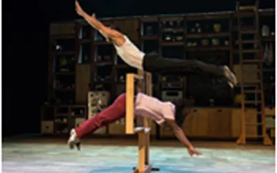
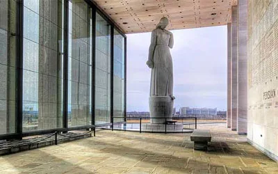
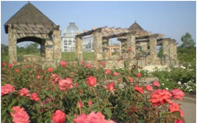
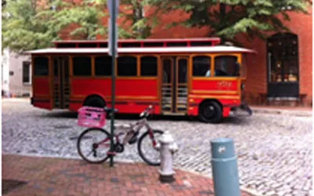

## **Have a question about Entertainment and Landmarks in Richmond**

Check out our Entertainment and Landmarks guide to learn all the amazing places in town

[Altria Theater
](http://www.altriatheater.com/)

[804-592-3368](<tel:\(804\) 592-3368>)

“This Theater, ranking high among the ten greatest in the United States, has been built and and will be operated as ‘Richmond’s Own Theater.’”
**6 N Laurel St, Richmond, VA 23220**

[Virginia War Memorial](http://www.vawarmemorial.org/VAWM/default.aspx)

[804-786-2060](tel:804-786-2060)

“Virginia’s War Memorial honors our fallen heroes by passing their stories of sacrifice forward to future generations.”
**621 S Belvidere St, Richmond**

[Lewis Ginter Botanical Garden](http://www.lewisginter.org/)

[804-262-9887](tel:804-262-9887)

“A year-round beauty on an historic property with more than 50 acres of spectacular gardens, dining, and shopping.”
**1800 Lakeside Ave, Richmond, VA 23228-4700**

[RVA Trolley Landmark Tours](http://rvatrolley.biz/pricing/richmond-landmark-tour/)

[804-343-1850](tel:804-343-1850)

“See the sights and learn about Richmond’s landmarks, riverfront, architecture and history.”
**405 North 3rd Street, Richmond, VA 23219**
