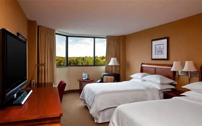
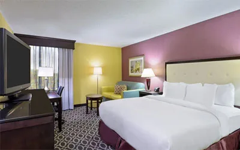
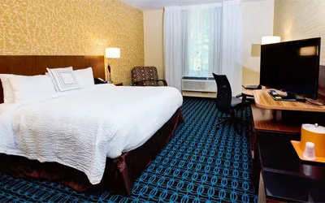
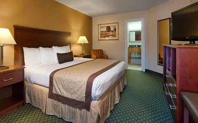
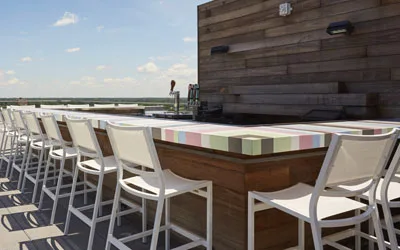

## **Have a question ? Where to stay in Richmond**

Check out our Richmond hotel guide to learn all the amazing places to stay in town

[Four Points by Sheraton Richmond](http://www.fourpointsrichmond.com/)

[866-925-7881](tel:+18669257881)

“Four Points by Sheraton Richmond is located among beautifully landscaped grounds, walking paths, and serene lakes in southest Virginia.”

[Doubletree by Hilton Richmond-Midlothian](http://doubletree3.hilton.com/en/hotels/virginia/doubletree-by-hilton-hotel-richmond-midlothian-RICKSDT/index.html)

[855-239-9397](tel:+18552399397)

“Our spacious guest rooms, feature a microwave, refrigerator, comfortable Serta beds, an executive work area with ergonomic chairs and complimentary WiFi.”

[Fairfield Inn & Suites by Marriott Richmond West](http://www.marriott.com/hotels/travel/ricfw-fairfield-inn-and-suites-richmond-midlothian/)

[855-239-9483](tel:+18552399483)

“The brand new Fairfield Inn & Suites Richmond-Midlothian is centrally located only minutes from downtown Richmond, Virginia and everywhere in between.”

[Best Western plus Governer’s Inn](https://www.bestwestern.com/en_US/book/hotel-details.47077.html?iata=00171890&ssob=BLBWI0003G&cid=BLBWI0003G:yext:website:47077)

[866-925-8648](tel:+18669258648)

“The Governor’s Inn Hotel mixes the best in hospitality with key locations. From Sportsplex to the Chesterfield Indoor Aquatic Center, it’s dun for the whole family just minutes away from this Best Western Plus.”

[Quirk Hotel](https://www.destinationhotels.com/quirk-hotel)

[+1 804-340-6040](tel:+18043406040)

“Set in a 1916 downtown department store, this upscale boutique hotel is 2 miles from the Virginia Museum of Fine Arts.”
