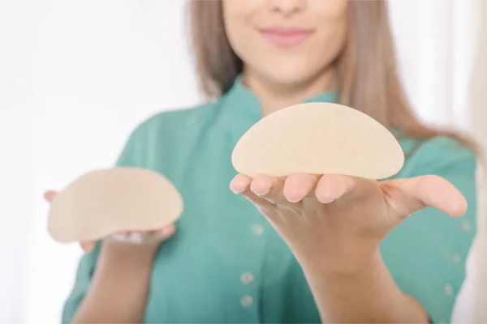

## Types of breast implants

-   **Saline implants –** Saline implants are made from salt water solution and because of this, they’re a safer option in the case of a silent rupture. Saline implants can be used in breast augmentation surgery in all women over the age of 18. Saline implants can be filled after they’re put in place, making them ideal for transaxillary breast augmentation.
-   **Silicone implants –** Silicone implants are the major alternative to saline. They are made from plastic gel (gel) and many women find that they feel more natural when compared to saline implants.
-   **IDEAL implants –** IDEAL implants are a type of saline implant that manage to combine a lot of the benefits of saline and silicone. Although they are filled with saline, the internal structure of IDEAL implants means they’re able to achieve a natural feel with still retaining the safety benefits of saline implants.
-   **Gummy Bear implants –** Gummy Bear implants are a type of silicone implant that are made from cohesive gel. This basically means that they retain their shape better and in the event of a rupture, they will not leak in the same way that regular silicone implants do. Gummy Bear implants were approved by the FDA in early 2012.

## Choosing the perfect breast implant

**When it comes to the right choice of implants for a breast augmentation, there is no one-size-fits-all approach.**

The type of breast implants used will depend on a few key factors, such as your personal preference for appearance and feel, how the implants will be inserted, if they’ll be placed above or below the chest muscle etc.

Dr Lynam has a vast amount of experience performing breast augmentation surgery and therefore can advise patients best on the right type of implants to use for their particular wants and needs.

### Choose one of our breast procedures to learn more:

## Saline implants

Browse Saline implants

[View more](/implants/saline-implants/)

## Silicone implants

Browse Silicone implants

[View more](/implants/silicone-implants/)

## Ideal Implants

Browse Ideal Implants

[View more](/implants/ideal-implants/)

## Gummy Bear Implants

Browse Gummy Bear Implants

[View more](/implants/gummy-bear-implants/)

## Implant FAQ

Browse Implant FAQ

[View more](/implants/implant-faq/)

## How long do they last?

Browse How long do they last?

[View more](/implants/how-long-do-they-last/)

## Silicone vs Saline

Browse Silicone vs Saline

[View more](/implants/silicone-vs-saline/)

## Tear Drop vs Round

Browse Tear Drop vs Round

[View more](/implants/tear-drop-shaped-vs-round/)

## Textured vs Smooth

Browse Textured vs Smooth

[View more](/implants/textured-vs-smooth/)

## Choosing the right size

Browse Choosing the right size

[View more](/implants/choosing-the-right-size/)

## Choosing the right type

Browse Choosing the right type

[View more](/implants/choosing-the-right-type/)
