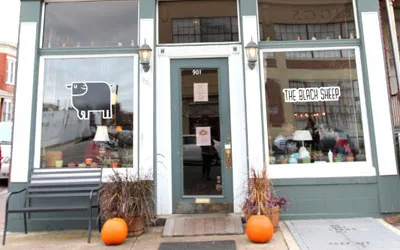
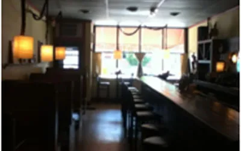
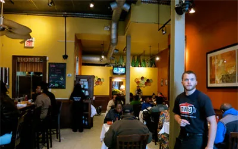
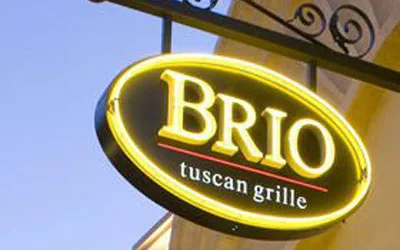

## **Have a question ? Where to stay in Richmond**

Check out our Richmond Restaurants guide to learn all the amazing places to stay in town

[The Black Sheep
](http://www.blacksheeprva.com/)

[804-648-1300](tel:804-648-1300)

Located in Richmond, Virginia’s historic Carver District, The Black Sheep serves new Southern and Cajun cuisine, and our infamous battleships.

[Cafe Rustica](http://www.caferusticarva.com/)

[804-255-8811](tel:\(804\)255-8811)

Mediterranean and German dishes freshly prepared and served in a warm, casual atmosphere.

[Mama J’s Kitchen](http://mamajskitchen.com/)

[804-255-7449](tel:\(804\)255-7449)

“Mama J’s is Richmond’s premiere soul food dining experience.  great southern
food with outstanding service in a relaxing atmosphere.”

[Brio Tuscan Grille](http://www.brioitalian.com/stony_point_fashion_park.html)

[804-272-2255](tel:804-272-2255)

“Enjoy delectable chef-inspired Italian dishes and wonderful wines in a cozy setting.”
